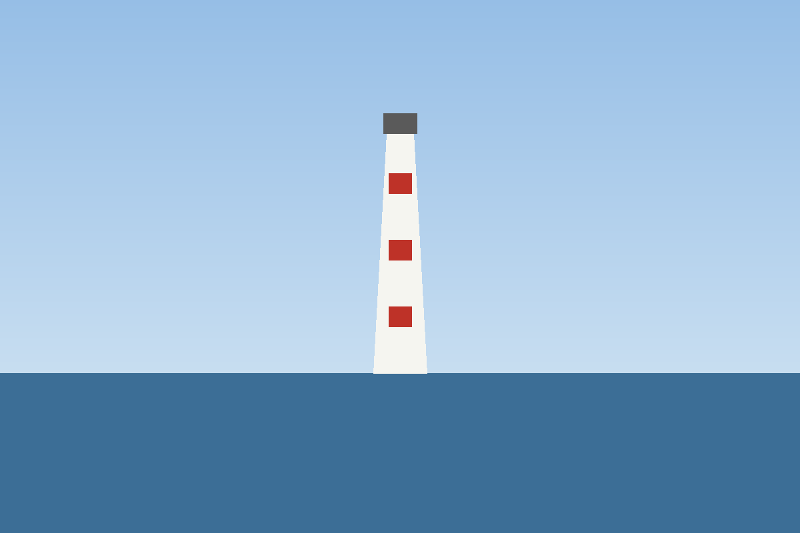

# El faro {#chap-faro}

Marta vivía en la última casa del pueblo, la que miraba al mar desde lo alto de la punta. Cada tarde, cuando el sol empezaba a bajar, subía los ciento doce escalones del faro con su abuelo para encender la luz que guiaba a los barcos.

El abuelo contaba los escalones en voz alta, y Marta aprendió los números así, de uno en uno, con el olor a sal y a aceite de la lámpara. Al llegar arriba, el viento les despeinaba y el mundo entero parecía caber en la ventana redonda.

<figure id="fig-faro"><figcaption>El faro de la punta en un día de calma</figcaption></figure>

Como se ve en la @fig-faro, el faro tenía tres franjas rojas, una por cada naufragio que su luz había evitado desde que lo construyeron[^franjas]. El abuelo decía que algún día pintarían la cuarta, y que ese día sería una fiesta para todo el pueblo.

[^franjas]: Es una leyenda del pueblo. Las franjas, en realidad, sirven para que los marineros reconozcan el faro de día.

—¿Y si un barco no ve la luz? —preguntó Marta una noche.

—Para eso estamos nosotros —respondió el abuelo—. Una luz que nadie cuida se apaga, y una que alguien cuida dura más que el que la encendió.

Marta no entendió del todo la respuesta, pero la guardó, como se guardan las conchas raras en el bolsillo, para mirarla otro día con más calma.

Los inviernos en la punta eran largos. Las tardes se acortaban, el mar se volvía gris y los barcos pasaban más lejos, como si también tuvieran frío. Marta hacía los deberes en la mesa de la cocina mientras el abuelo reparaba redes junto a la estufa y escuchaba la radio del puerto.

Algunas noches, la radio hablaba de tormentas que venían del norte. Entonces el abuelo se quedaba callado, miraba el barómetro de la pared y le daba dos golpecitos con el dedo, como si quisiera despertarlo.
