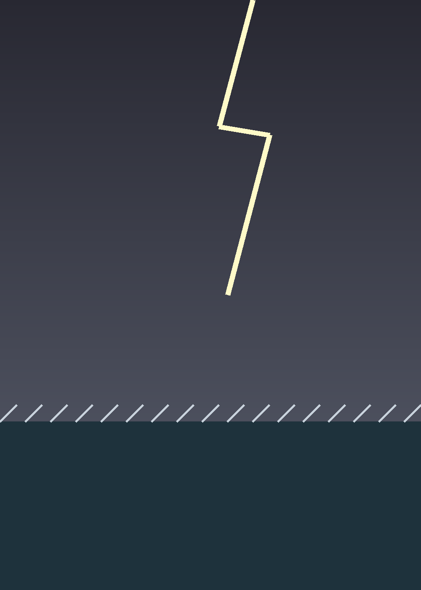

<figure class="fullpage"></figure>

# El regreso {#chap-regreso}

Por la mañana el mar estaba tranquilo, como si no se acordara de nada. En el puerto, los pescadores contaban que un pesquero había visto la luz del faro en lo peor de la noche y había encontrado el camino de vuelta.

Marta volvió a leer el @chap-faro, el cuaderno y las notas de la tabla, y entendió por fin lo que el abuelo le había dicho sobre las luces que alguien cuida.

Esa primavera pintaron la cuarta franja. Marta sostuvo la escalera, y el abuelo le dejó dar la última pincelada.
